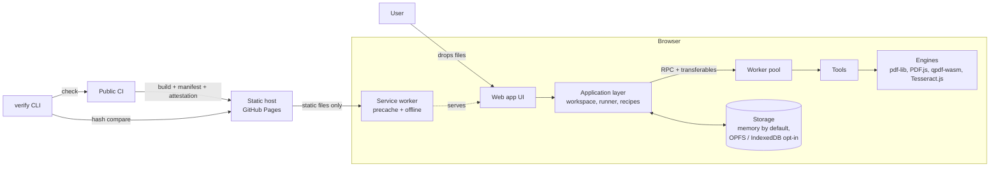
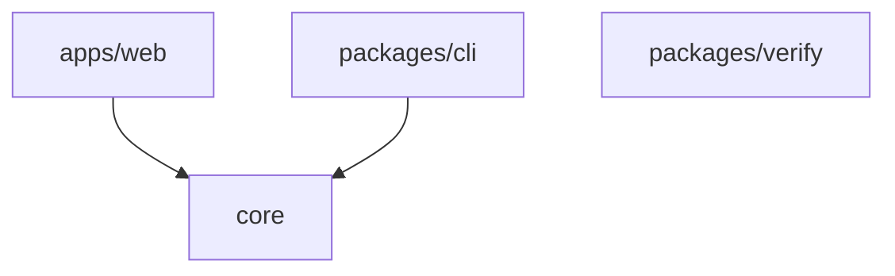
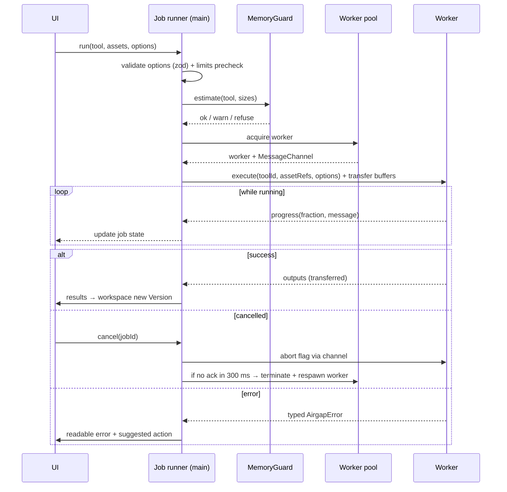

# ARCHITECTURE: Airgap PDF

> Status: **draft v0.1**, written before the first line of code. Sections marked **[SPIKE]** depend on a
> time-boxed experiment in [TODO.md](./TODO.md) and may change. Decisions are recorded as ADRs in
> `docs/adr/`; the index is in §24.

## Table of contents

1. [Purpose, scope, non-goals](#1-purpose-scope-non-goals)
2. [Principles](#2-principles)
3. [System context](#3-system-context)
4. [Monorepo layout and dependency rules](#4-monorepo-layout-and-dependency-rules)
5. [Domain model](#5-domain-model)
6. [The tool contract](#6-the-tool-contract)
7. [Engines](#7-engines)
8. [Execution model](#8-execution-model)
9. [Storage](#9-storage)
10. [Recipes](#10-recipes)
11. [Trust architecture](#11-trust-architecture)
12. [Security for untrusted PDFs](#12-security-for-untrusted-pdfs)
13. [Redaction design](#13-redaction-design)
14. [Compression design](#14-compression-design)
15. [X-Ray and Time Machine design](#15-x-ray-and-time-machine-design)
16. [Compare design](#16-compare-design)
17. [UI architecture](#17-ui-architecture)
18. [PWA and platform integration](#18-pwa-and-platform-integration)
19. [Build and deploy](#19-build-and-deploy)
20. [Testing strategy](#20-testing-strategy)
21. [Diagnostics without telemetry](#21-diagnostics-without-telemetry)
22. [Browser support and degradation](#22-browser-support-and-degradation)
23. [Performance budgets](#23-performance-budgets)
24. [ADR index](#24-adr-index)
25. [Failure modes and mitigations](#25-failure-modes-and-mitigations)

---

## 1. Purpose, scope, non-goals

**Purpose.** A PDF toolkit that runs entirely client-side, whose privacy properties are *verifiable*
rather than promised, and which goes beyond the standard toolbox with redaction that is checked,
leak auditing, revision recovery, comparison, and reproducible pipelines.

**In scope**
- Static hosting only (GitHub Pages is the reference target; nothing may depend on it specifically).
- Browser-first, with a Node CLI that shares the same core and tools.
- Offline operation after first load.

**Non-goals**
- Any server component, account system, sync service, analytics or crash reporting.
- Office format conversion.
- PDF/A and PDF/UA conversion (a read-only checker is a parking-lot idea).
- Cracking or bypassing passwords.
- Cryptographic (PAdES) signing in v1.

---

## 2. Principles

These are the rules we resolve disagreements with.

| # | Principle | Consequence |
|---|---|---|
| P1 | **Bytes never leave the device.** | No upload path exists in code. CI fails on any off-origin request. |
| P2 | **Static only.** | No server, no edge functions, no headers we cannot set from a static host. |
| P3 | **Core is DOM-free.** | `packages/core` and `packages/tools` run in the browser *and* Node. UI is a thin layer. |
| P4 | **One schema, three surfaces.** | A tool's zod options schema generates the UI form, the CLI flags and recipe validation. |
| P5 | **Every PDF is hostile.** | Resource limits, no script execution, worker isolation. |
| P6 | **Verify, don't claim.** | Anything we say about privacy or redaction has a mechanical check behind it. |
| P7 | **Degrade, don't crash.** | Missing browser feature or low memory leads to a clear message and a reduced path, never a frozen tab. |
| P8 | **Boring technology.** | Prefer well-known libraries behind our own interfaces. Swap engines without touching tools. |
| P9 | **Lazy by default.** | Heavy engines load only when a tool needs them, then cache for offline. |
| P10 | **Ephemeral by default.** | Files live in memory. Persistence is explicit and wipeable. |

---

## 3. System context



There is exactly one network relationship: the browser downloads static files from the host. Nothing
flows the other way.

---

## 4. Monorepo layout and dependency rules

Start lean in M0/M1 with `apps/web` and `packages/core`; add `packages/verify` in M2 and `packages/cli` in M9.

```
airgap-pdf/
├─ apps/
│  └─ web/                 React + Vite PWA
│     ├─ src/
│     │  ├─ app/           routing, shell, providers
│     │  ├─ features/      workspace, jobs, recipes, trust-panel, command-palette
│     │  ├─ engines/       pdf-lib, pdfjs, qpdf, tesseract adapters behind core interfaces
│     │  ├─ tools/         one folder per tool + custom editors
│     │  ├─ ui/            design-system primitives
│     │  ├─ workers/       worker entry points + blob CSP shim
│     │  └─ i18n/
│     └─ public/           manifest, icons, fonts, pdfjs (cmaps + standard_fonts), wasm
├─ packages/
│  ├─ core/                contract, errors, limits, assets, recipes, page ranges
│  ├─ verify/              manifest + provenance verifier (M2)
│  └─ cli/                 Node entry, schema → flags (M9)
├─ corpus/  e2e/  bench/  docs/adr/  scripts/
```

**Dependency direction:**



Rules:
- `core` imports no other workspace package and no DOM or Node globals. It may use `crypto.subtle`,
  `structuredClone`, `TextEncoder` and other APIs available in both runtimes.
- Tools obtain engines through `ToolContext`, never by importing engine libraries directly.
  That is what keeps tools engine-agnostic and testable with fakes.
- `apps/web` and `cli` are composition roots: they wire engines into contexts.
- `verify` is standalone.

---

## 5. Domain model

```ts
// packages/core/src/asset.ts
export type AssetId = string; // unique ID (SHA-256 content-addressing optional/deferred)

export interface Asset {
  id: AssetId;
  name: string;               // display name, sanitized
  stem: string;               // name without extension
  mime: string;               // from magic bytes, never from the extension
  size: number;
  blob: Blob;                 // canonical backing store (structured-cloneable, disk-backed by browser)
}

export interface Version {
  id: string;                 // ulid
  assetId: AssetId;
  parent?: string;            // previous Version.id
  producedBy?: { tool: string; options: unknown; inputs: AssetId[] };
  createdAt: number;
}

export interface Workspace {
  items: Map<string, WorkspaceItem>;   // user-visible documents
  history: Version[];                  // immutable log
  head(itemId: string): Version;       // undo/redo = moving a pointer
}
```

Key properties:
- **`Blob`-backed.** Canonical assets live on the main thread as `Blob`s (structured-cloneable into workers without detaching the main thread's copy if a worker is hard-killed or OOMs).
- **Immutable.** A tool never mutates an input. It produces new assets. Undo is a pointer move.
- **Provenance.** `producedBy` records which tool and options created a version, so a workspace can be
  replayed as a recipe ("Export history as recipe").

---

## 6. The tool contract

A tool is a pure-ish function from assets and validated options to assets, plus metadata.

```ts
// packages/core/src/tool.ts
import type { z } from 'zod';

export type Capability =
  | 'pdf.edit' | 'pdf.render' | 'pdf.text' | 'pdf.crypto' | 'pdf.repair' | 'ocr' | 'image.codec';

export interface ToolDefinition<O extends z.ZodTypeAny> {
  id: string;                                   // stable kebab-case; used in recipes and CLI
  name: string;
  summary: string;
  category: 'organize' | 'convert' | 'edit' | 'protect' | 'inspect' | 'compare' | 'scan';
  accepts: { mime: string[]; min: number; max: number | 'many' };
  produces: 'pdf' | 'images' | 'text' | 'zip' | 'report';
  runtime: Array<'browser' | 'node'>;
  needs?: Capability[];                         // engines resolved lazily; absent → EngineUnavailable
  options: O;                                   // zod schema: UI form + CLI flags + recipe validation
  ui?: UiHints<z.infer<O>>;                     // optional: custom component, field order, labels, help
  memory?: { multiplier: number };              // feeds MemoryGuard (peak ≈ input × multiplier)
  deterministic?: boolean;                      // same input + options → byte-identical output
  run(ctx: ToolContext, input: Asset[], options: z.infer<O>): Promise<ToolResult>;
}

export interface ToolContext {
  pdf: PdfFacade;                 // edit engine facade (open, copy pages, save)
  render: RenderFacade;           // raster + text extraction
  engines: EngineRegistry;        // escape hatch for specialised capabilities
  progress(fraction: number, message?: string): void;   // must be monotonic
  signal: AbortSignal;            // cooperative cancellation; hard cancel terminates the worker
  limits: Readonly<Limits>;
  log: (level: 'debug' | 'info' | 'warn', msg: string, data?: unknown) => void;  // never file content
}

export type ToolResult =
  | { ok: true; outputs: Asset[]; report?: Report }
  | { ok: false; error: AirgapError };

export const defineTool = <O extends z.ZodTypeAny>(def: ToolDefinition<O>) => def;
```

### Universal invariants (enforced by the shared test harness)

Every tool, automatically, must:
1. Produce outputs that re-open successfully in at least two independent parsers.
2. Never mutate its input assets.
3. Emit monotonic progress in `[0, 1]`.
4. Stop promptly on `signal` abort and leave no partial state.
5. Make **zero** network requests.
6. Respect `limits` (and fail with `LimitExceeded`, not by running out of memory).
7. If `deterministic: true`, produce byte-identical output across two runs.
8. Reject options that do not match its schema with a readable error.

### Schema-derived surfaces

| Surface | Derived from | Notes |
|---|---|---|
| Web form | zod schema + `ui` overrides | Simple tools use generated fields; complex tools (Merge, Split, Organizer, Redact) use hand-written React forms via `ui` overrides |
| CLI | zod schema | `--degrees 90 --pages 1-3`; `--help` generated from `.describe()` strings |
| Recipe validation | zod schema | Same parser, so a recipe valid in the UI is valid in the CLI |
| Docs | metadata + schema | Tool reference pages are generated, not hand-written |

---

## 7. Engines

Tools talk to **capabilities**, engines implement them. This is the answer to "what if library X dies".

```ts
export interface PdfEngine {
  readonly id: string;
  open(asset: Asset, opts?: { password?: string }): Promise<PdfDoc>;
  create(): Promise<PdfDoc>;
}
export interface PdfDoc {
  readonly pageCount: number;
  resolveRange(r: PageRange): number[];
  page(i: number): PdfPage;
  copyPagesFrom(src: PdfDoc, indices: number[], at?: number): void;
  removePage(i: number): void;
  setMetadata(m: Partial<Metadata>): void;
  save(opts?: { name?: string; objectStreams?: boolean }): Promise<Asset>;
}
```

### Engine selection matrix

Licenses must be verified in spike S8 before adoption. Treat this table as the starting hypothesis.

| Capability | Candidate | License | Size | Loaded | Notes |
|---|---|---|---|---|---|
| `pdf.edit` | `@cantoo/pdf-lib` | MIT | small | main | Actively maintained fork (v2.11.x); supports `useObjectStreams` and AES-256 `encrypt()`; kept behind `PdfEngine` interface (bus-factor hedge) |
| `pdf.render`, `pdf.text` | PDF.js | Apache-2.0 | medium | on demand | Worker build (shimmed); scripting disabled; `isEvalSupported: false`; self-host `cmaps/` + `standard_fonts/` |
| `pdf.crypto`, `pdf.repair` | `qpdf` compiled to WASM | Apache-2.0 | medium | on demand | Deferred until repair, linearize, or raw stream inspection is needed |
| `ocr` | Tesseract.js | Apache-2.0 | large | on demand | Self-hosted language packs, per-language download; worker must use `blob:` shim |
| `image.codec` | Browser `createImageBitmap` + WASM codecs (`@jsquash/jpeg`) | Apache-2.0 / BSD | small-medium | on demand | HEIC/AVIF handling per S10 |

**No AGPL engines.** Strong compressors and renderers (Ghostscript, MuPDF) are dual-licensed AGPL-3.0 /
Commercial. We exclude them permanently in favour of permissive-licensed engines and accept slightly
lower compression ratios (ADR-0002).

### Loading

- Engines register **factories**. The first call triggers a dynamic `import()` of the engine chunk and
  its `.wasm`, fetched from our own origin, then cached by the service worker.
- A tool declaring `needs: ['ocr']` on a platform without a loadable OCR engine fails fast with
  `EngineUnavailable`, and the UI explains why instead of showing a stack trace.

---

## 8. Execution model

### 8.1 Worker pool

- Pool size: `clamp(navigator.hardwareConcurrency - 1, 1, 4)`.
- Each worker lazily instantiates engines; rely on Service Worker cache + `WebAssembly.instantiateStreaming`
  (do not `postMessage` compiled `WebAssembly.Module` objects across workers).
- Because WASM linear memory never shrinks back to the OS, **terminate idle heavy workers** (e.g. after
  `qpdf` or `Tesseract.js` jobs finish) to prevent OOM on mobile.
- RPC through **Comlink**. Inputs are passed as structured-cloneable `Blob`s (safe across worker
  termination); outputs return as transferable `ArrayBuffer`s or `Blob`s.
- The main thread never parses a PDF. It handles UI, orchestration and canvas display only.

### 8.2 Job lifecycle



### 8.3 Cancellation

- **Cooperative first:** an abort flag is shared over a dedicated `MessageChannel`. Tools must check
  `ctx.signal` between units of work.
- **Hard cancel fallback:** if the worker has not acknowledged within ~300 ms (stuck in WASM), the
  worker is terminated and replaced. Cheap, safe, and the only reliable way to stop synchronous WASM.
- `AbortSignal` objects themselves are not transferable through Comlink, so the worker constructs a local
  `AbortController` driven by the channel.

### 8.4 Memory guard

- Estimate peak = `Σ input sizes × tool.memory.multiplier + engine overhead`.
- Compare with a budget derived from `navigator.deviceMemory` when present, otherwise conservative
  per-platform defaults (iOS Safari is the tightest). Multipliers and budgets are calibrated in **S5**.
- Outcomes: **ok**, **warn** (continue, but suggest closing tabs), **refuse** (offer a reduced path,
  e.g. process in chunks, or split first).
- On an actual `OutOfMemory` or a worker crash, surface a typed error and keep the workspace intact.

### 8.5 Error model

```ts
export abstract class AirgapError extends Error {
  abstract readonly code: string;
  readonly userMessage: string;       // plain-language, translatable key + params
  readonly action?: SuggestedAction;  // "Enter password", "Try Safe mode", "Split the file first"
}
// PasswordRequired | CorruptPdf | UnsupportedFeature | LimitExceeded | OutOfMemory |
// Cancelled | EngineUnavailable | InvalidOptions
```

Errors are plain-data serializable (code + fields), reconstructed on the main thread, so
`instanceof` works after crossing the worker boundary.

---

## 9. Storage

### 9.1 Default: memory only (ADR-0005)

- Assets live in worker/main memory and are dropped when the tab closes.
- Large assets are held as `Blob`s (which browsers may back with disk) and read lazily, not as long-lived
  `Uint8Array`s in the JS heap.

### 9.2 Opt-in persistence (deferred to M2/M3)

- Toggle: **Remember my workspace**. Off by default, with a short explanation.
- Backing store: **OPFS** (origin-private file system) for blobs, **IndexedDB** for metadata and the
  version log. IndexedDB-only fallback where OPFS is unavailable.
- Quota: use `navigator.storage.estimate()`, show usage, evict least-recently-used history first, never
  evict the current head silently.
- **Wipe everything**: one click deletes OPFS entries, IndexedDB databases, Cache Storage for user
  data (not the app shell), and resets the workspace. E2E-tested.
- Signatures, recipes and settings follow the same toggle. With persistence off they live for the
  session only (with an explicit "export" option).

### 9.3 Never stored

- File *contents* in logs, diagnostics, URLs, `localStorage`, or anywhere outside the opt-in store.
- Anything in the URL except recipes (fragment) and routing state.

---

## 10. Recipes

A recipe is a declarative pipeline over tools.

```jsonc
{
  "v": 1,
  "name": "Send-safe contract",
  "steps": [
    { "tool": "merge",    "options": {} },
    { "tool": "sanitize", "options": { "metadata": true, "javascript": true } },
    { "tool": "watermark","options": { "text": "CONFIDENTIAL", "opacity": 0.12 } }
  ]
}
```

Semantics:
- **Data flow:** each step's outputs become the next step's inputs. A step that accepts `max: 1` over
  multiple inputs runs once per input (map); a step that accepts `many` receives the whole set (reduce).
  The rule is explicit and shown in the builder UI.
- **Validation:** each step's `options` is parsed with the tool's own zod schema at load time. Unknown
  tools or invalid options fail with a precise path (`steps[2].options.opacity`).
- **Determinism:** a recipe plus the same inputs gives the same outputs (tools that cannot guarantee it
  say so via `deterministic: false`).
- **Versioning:** `v` is the recipe schema version. Migrations are pure functions
  `v1 → v2 → …`, unit-tested. Tool option schemas version independently through zod defaults and
  `.catch()` where appropriate.
- **Sharing:** `deflate(JSON)` → base64url → URL **fragment** (`#/recipe?r=...`). Fragments are never
  sent in HTTP requests. A hard cap (≈ 8 KB encoded) avoids unwieldy links; larger recipes are shared as
  files.
- **No files, no secrets:** passwords are never serialisable into recipes. A step that needs one prompts
  at run time.
- **History as recipe:** the workspace version log can be exported as a recipe for replay.

---

## 11. Trust architecture

The product's central claim is "your files never leave the device". This section defines what we can
*mechanically* defend, and, equally important, what we cannot.

### 11.1 Content Security Policy (meta tag)

GitHub Pages cannot set response headers, so the policy is delivered by `<meta http-equiv>`. A meta CSP
cannot express `frame-ancestors`, `report-uri` or `sandbox`, but does cover the directives that matter here.

```html
<meta http-equiv="Content-Security-Policy" content="
  default-src 'none';
  script-src 'self' 'wasm-unsafe-eval';
  worker-src 'self' blob:;
  style-src 'self';
  img-src 'self' blob: data:;
  font-src 'self';
  media-src 'self' blob:;
  connect-src 'self';
  manifest-src 'self';
  base-uri 'none';
  form-action 'none';
  object-src 'none';
">
```

Notes:
- `connect-src 'self'` denies `fetch`/XHR/WebSocket/EventSource/beacon to any other origin from the document.
- `'wasm-unsafe-eval'` is required to compile WebAssembly. It does not enable JavaScript `eval`.
- No `'unsafe-inline'` anywhere. Vite output is configured to avoid inline scripts and styles; dynamic
  styles use CSSOM or CSS variables, not `style=` strings where CSP would block them.
- `img-src blob: data:` is needed for rendered pages and thumbnails.
- A unit test parses `index.html` and asserts this policy, so it cannot be loosened silently.

### 11.2 Do workers obey the page's CSP? **[SPIKE S1]**

A dedicated worker loaded from a URL gets its CSP from *its own response headers*, which we cannot set on
Pages (verified in S1: a direct URL worker ignores the page's `<meta>` CSP). Workers created from `blob:`
URLs inherit the creating document's policy, **but** `fetch(workerUrl) → Blob` crashes on Vite ES module
workers that import relative chunks (`./chunk.js`).

**Design (verified in Chromium; M0 must verify Firefox and WebKit before ADR-0009 is accepted):**
Bootstrap every worker (including library-spawned workers for PDF.js and Tesseract.js) via a 1-line
`blob:` `import` shim using the absolute worker URL:
```ts
const abs = new URL(workerUrl, location.href).href;
const blob = new Blob([`import ${JSON.stringify(abs)};`], { type: 'application/javascript' });
const worker = new Worker(URL.createObjectURL(blob), { type: 'module' });
```
Because the imported module has its real HTTP URL, relative chunk imports and `import.meta.url` WASM
resolution work, while the `blob:` worker inherits the page's `connect-src 'self'`.

**Service workers** are not governed by `<meta>` CSP. Therefore:
1. The Playwright zero-network fixture must observe **Service Workers** as well as pages and dedicated workers.
2. Worker bootstrap also wraps `fetch`, `XMLHttpRequest`, `WebSocket`, `EventSource`, `navigator.sendBeacon`,
   and `importScripts` as defence in depth to report to the Trust panel.

### 11.3 Trust panel and request observation

The panel shows:
- Status pill: **`"0 observed requests · CSP active"`** (never `"CSP enforced"`, since a malicious build
  could strip the `<meta>` tag—that is what `@airgap-pdf/verify` detects).
- The active CSP and allowed origins (read from the document).
- Session request log: main thread via `PerformanceObserver('resource')`; worker requests via the
  wrapped APIs in §11.2 reporting over the job channel.
- Persistence state and storage usage.
- Offline-readiness (service worker precache complete).
- Build identity: commit SHA, build time, manifest hash, with the `npx @airgap-pdf/verify` command.

**Labelling is deliberate**: it says *observed*, not *proven*. Resource timing misses some request
types and cannot see from outside the page's own contexts. The panel links to the "What we do not
claim" section.

### 11.4 Mechanical guarantees in CI

| Check | How | Fails the build when |
|---|---|---|
| Zero off-origin requests | Playwright global fixture subscribes to `page.on('request')` and `context.on('request')` including workers and service workers | any request host ≠ app origin |
| Offline operation | After first load, `context.setOffline(true)` and run each tool | any tool needs the network |
| CSP integrity | Parse `index.html`, compare to the golden policy | the policy changes without an updated golden file |
| No third-party origins in source | Lint/regex over built output for `https?://` hosts not on an allowlist | new external host appears |
| No telemetry deps | Dependency denylist (known analytics/crash-reporting packages) | one is added |
| License check | `license-checker` against an allowlist | a disallowed license appears |

### 11.5 Supply-chain integrity

- **Reproducible builds:** pinned Node and pnpm versions, `--frozen-lockfile`, no timestamps or
  absolute paths in outputs. Two CI runs of the same commit should produce identical `dist/`.
- **Manifest:** `airgap.manifest.json` lists the SHA-256 of every shipped file plus commit and build time.
- **Provenance attestation:** `actions/attest-build-provenance` signs a statement binding `airgap.manifest.json`
  (and key entry bundles, staying well under GitHub's 1,024-subject limit) to the workflow run and commit.
- **`@airgap-pdf/verify`:** fetches the deployed files, recomputes hashes, compares to the manifest and verifies
  the attestation with `gh attestation verify` semantics.
- **Self-hosted everything:** fonts, WASM, language data, icons. No CDNs, so there is nothing to pin with SRI.
- **Dependency hygiene:** Renovate/Dependabot with a 14-day minimum release age; lockfile diffs are
  reviewed; install scripts are disabled by default (`pnpm` `onlyBuiltDependencies` allowlist).
- **Actions pinned by SHA**, minimal `permissions:` per job.

### 11.6 Threat model (summary)

| Threat | In scope? | Mitigation | Residual risk |
|---|---|---|---|
| Developer/maintainer adds an upload path | Yes | Zero-network CI, CSP, review checklist, public history | Malicious maintainer with CI control; attestations make it detectable, not impossible |
| Compromised dependency exfiltrates data | Yes | CSP `connect-src 'self'`; worker bootstrap; release-age cool-off; lockfile review; zero-network e2e | Dependency could encode data into a same-origin request (no receiving server, so benign) or exploit an unmitigated channel |
| Malicious PDF attacks the app | Yes | §12 limits, no script execution, worker isolation | Engine bugs (parser CVEs) remain possible; keep dependencies current |
| Altered deployment served from the official origin | Partly | Manifest + attestation + `verify` | User must actually run verification |
| Lookalike site serving a modified copy | Out of scope technically | Documentation; `verify` against the official repo | User education |
| Compromised browser/OS/extension | Out of scope | n/a | Fully residual |
| Shoulder-surfing, shared computer | Partly | Ephemeral default, Wipe everything | Browser memory/disk caches outside our control |

---

## 12. Security for untrusted PDFs

PDFs are a notorious attack surface. Parsing happens only in workers, and with limits.

### 12.1 Resource limits (initial values; tune from corpus + S5)

| Limit | Initial value | Why |
|---|---|---|
| Max input size | 500 MB desktop / 150 MB mobile (soft; MemoryGuard decides) | avoid OOM |
| Max pages processed in one job | 5,000 | pathological page trees |
| Max decoded size of any single stream | 256 MB | decompression bombs |
| Max total decoded bytes per job | 2 GB | same |
| Max object nesting/recursion depth | 100 | circular or deep structures |
| Max canvas pixels | 16,777,216 (iOS-safe) | Safari canvas ceiling |
| Max rendered DPI | 300 (600 only on explicit request) | memory |
| No-progress watchdog | 30 s | WASM hangs |
| Max OCR page count per run | configurable, default 100 | time and memory |

### 12.2 Behavioural rules

- **No script execution.** PDF.js: `isEvalSupported: false`, scripting disabled, no `enableXfa`. JavaScript
  actions and launch actions are detected and reported, never run.
- **No HTML injection.** Text from PDFs (annotation contents, form values, bookmarks) is only ever
  rendered as text. A lint rule bans `innerHTML`/`dangerouslySetInnerHTML` outside a vetted helper.
- **Filename sanitisation.** Strip path separators and control characters; cap length; avoid reserved names;
  de-duplicate on export.
- **Magic-byte sniffing.** Detect PDF vs image by signature, not by extension or MIME from the OS.
- **Worker isolation.** Each job gets its own worker context; crash or termination cannot corrupt the
  workspace, which lives in the main thread/storage layer.
- **No `eval`/`new Function`** in our code; CSP enforces it for the app itself.
- **Zip safety** when we create archives: names normalised, no `..` segments, size budget enforced.
- **Link handling.** URI actions inside PDFs are displayed, never auto-followed; user-initiated opens use
  `rel="noopener noreferrer"`.
- **Fuzzing.** A fuzz harness mutates corpus PDFs and asserts: no unhandled exception escapes, every run
  ends within the timeout, memory stays within limits.

---

## 13. Redaction design

Redaction is the flagship and the highest-risk feature. A false sense of security is worse than no tool.

### 13.1 Modes

| Mode | Mechanism | Pros | Cons |
|---|---|---|---|
| **Safe** (default) | Rasterise affected pages at chosen DPI, burn redaction boxes into the image, and rebuild the entire document cleanly so no old structure/revisions survive | Nothing underneath can survive. Simple to reason about | Loses text selectability/tags on those pages; larger files |
| **Precise** **[SPIKE S4]** | Parse the content stream; remove or clip text-showing and image operators intersecting redaction regions; neutralise related resources | Keeps text layer elsewhere; small output | Complex: font encodings, Type 3 fonts, transparency groups, form XObjects, inline images |

Optional text-layer rebuild after Safe mode: run OCR on the rasterised page so the remaining content is
searchable again, with the redacted region provably blank (OCR runs on the already-redacted bitmap).

### 13.2 Mandatory verification

After every redaction, run the **same verifier that powers Verify Redaction**:

1. Re-parse the output as an untrusted PDF.
2. **Extracted-text diff check:** the extracted-text diff before and after must equal *exactly* the redacted
   regions and nothing else (catches `TJ`-kerning-split words and unexpected survivors).
3. For each redacted string and region, search:
   - extracted page text (PDF.js, ordered and raw);
   - decompressed page content streams **and Form XObjects** (`/XObject /Subtype /Form`);
   - Tagged PDF structure tree (`/StructTreeRoot` `/ActualText`, `/Alt`, `/MCID`);
   - annotations (contents, appearance streams), form field values, bookmarks/outlines;
   - embedded files, XMP, Info metadata, `/PieceInfo`, thumbnails, and unreferenced/orphaned objects;
   - **previous revisions** inside the file (see §15);
   - rendered pixels in the redacted regions (should be uniform, catching outlined/vectorized glyphs).
4. Any hit fails the operation with the exact location, and the output is withheld.

The verifier is tested against an adversarial corpus (`corpus/redaction-fails/`) of known-bad
redactions: black rectangles over live text, annotation-only "redaction", revisions retaining original text.

### 13.3 Auditing others' redactions ("Verify Redaction")

Same engine, different input: detect likely redaction boxes (filled dark rectangles), then check
whether text, images or earlier revisions still exist beneath. Report findings with page, coordinates and a
text snippet **shown only to the user, never logged**.

### 13.4 UX safeguards

- Preview shows the *burned-in* result, not an overlay that merely looks redacted.
- A plain-language explanation of what Safe vs Precise guarantee.
- A redaction log exports **counts and positions only**, never the redacted content.

---

## 14. Compression design **[SPIKE S6]**

Compression is where server tools lean on Ghostscript. We stay permissive-licensed by default.

Pipeline (each stage optional, measured individually):
1. **Structural:** rewrite with object streams and cross-reference streams, drop unreferenced objects,
   deduplicate identical streams, strip unneeded metadata (user-toggleable).
2. **Images:** enumerate image XObjects; downsample to a target DPI (computed from displayed size);
   re-encode (JPEG via browser canvas or a WASM codec; flate for line art); skip images where the
   re-encode is not smaller; preserve soft masks and color spaces correctly.
3. **Fonts:** subset only if the engine supports it safely; otherwise leave alone.
4. **Guard:** if the output is not smaller than the input, return the original and say so.

Presets: **Light** (lossless structural), **Balanced** (≈150 DPI images), **Strong** (≈100 DPI, higher
JPEG compression), each showing an estimated saving before running.

Benchmark: `bench/compress/` with 20 real-world PDFs and a script that reports ratio, time, and a
perceptual diff (SSIM on rendered pages). Results are published; regressions fail CI by threshold.

If ratios are not competitive with permissive tools alone, ADR-0002 decides between adopting an AGPL
license for the project or an isolated engine pack.

---

## 15. X-Ray and Time Machine design

### 15.1 X-Ray

A read-only analysis pass producing a structured `Report`:

| Section | Source | Examples |
|---|---|---|
| Identity | Info dict, XMP | Author, company, title, producer, creator, original filename |
| Timeline | Dates, revision count | Created / modified, number of incremental updates |
| Active content | Names tree, OpenAction, annotations | JavaScript, launch actions, URI actions, submit-form actions |
| Hidden content | OCGs, annotation flags, white/transparent text, off-page content | Hidden layers, invisible text |
| Attachments | EmbeddedFiles, file-attachment annotations | Names, sizes, hashes |
| Images | Image XObjects | EXIF/GPS in embedded JPEGs, dimensions, color spaces |
| Forms | AcroForm | Field names + current values (shown to the user only) |
| Comments | Annotations | Authors, timestamps, text |

Each finding has `severity` (info/warn/risk), a plain-language explanation, and a `fix` that maps to a
Sanitize option. Reports export without file content (findings only), so they are safe to share.

### 15.2 Time Machine **[SPIKE S9]**

Incrementally updated PDFs append new objects and a new xref/trailer, ending with `%%EOF`. Earlier states
therefore remain recoverable.

Algorithm:
1. Scan raw bytes for `%%EOF` markers and validate the preceding `startxref` offset → candidate revision end offsets.
   Ignore the first `%%EOF` when a `/Linearized` dictionary is present, and handle `/XRefStm` hybrid-reference files.
2. For each offset, slice `bytes[0..offset]` and attempt to open with the lenient parser.
3. Deduplicate by page-content hash; order oldest → newest.
4. For each valid revision: render thumbnails, extract text, and offer *view / diff against next / export*.

Caveats surfaced in the UI: linearized files, files rewritten wholesale (no history), encrypted files
(need the password), hybrid-reference files. The tool says "no earlier revisions found", never "your file
is clean".

---

## 16. Compare design

- **Text diff:** extract positioned text per page; normalise whitespace and hyphenation; align pages
  (handle inserted/removed pages) then diff with Myers' algorithm at word level; classify as insert / delete
  / move where detectable.
- **Visual diff:** render both pages at the same DPI on `OffscreenCanvas` in a worker; align by
  detected content bounds; `pixelmatch` with tolerance; produce an overlay.
- **Views:** side-by-side, swipe, onion-skin, change list with jump-to.
- **Report export:** a PDF summarising changes (generated locally by the same engines).
- **Performance:** only visible pages are diffed first; the rest stream in; cancellable.

---

## 17. UI architecture

| Concern | Decision |
|---|---|
| Framework | React 18 + Vite + TypeScript (ADR-0003 D3) |
| State | Zustand stores: `workspace`, `jobs`, `settings`, `trust`; selectors, no prop-drilling; stores are serialisable where persistence is on |
| Routing | **Hash routing** (`#/tool/merge`, `#/recipe`, `#/embed/…`). No server rewrites needed on static hosts, and the fragment never reaches a server |
| Design system | CSS variables for tokens; self-hosted fonts (`@fontsource` / `public/fonts/`); Radix primitives for accessible behaviour; no runtime CSS-in-JS (CSP and perf) |
| Forms | Generated from zod schemas with an override registry for custom editors |
| Lists/thumbnails | Virtualised; render requests queued with an LRU cache and cancellation when scrolled away |
| Command palette | Generated from the tool registry; fuzzy search; recent tools |
| Drag and drop | Pointer/keyboard-accessible sorting (dnd-kit) for pages and files |
| Accessibility | WCAG 2.2 AA target; every editor keyboard-operable; focus management on route and dialog changes; `prefers-reduced-motion`; axe in CI |
| i18n | Message catalogues (Lingui or equivalent); no string concatenation; ICU plurals; RTL-ready layout via logical CSS properties |
| Theming | System / light / dark; high-contrast support |
| Mobile | Single-column workflows, large touch targets, camera scanner, share target |
| Errors | Error boundaries per feature; typed `AirgapError` rendered with a suggested action |

**Workflow principle:** *drop → choose → run → chain.* After a tool finishes, the result becomes the
working document with one-click "Next: …" suggestions (compress, sanitize, sign), which is how recipes
are discovered naturally.

---

## 18. PWA and platform integration

- **Service worker** (Workbox via `vite-plugin-pwa`): precache the app shell and core chunks; runtime-cache
  heavy WASM and language packs on first use with cache-first, versioned by hash.
- **Update flow:** never reload under the user. A new version is detected, installed in the background, and
  an "Update ready, reload when idle" prompt appears. Updating is blocked while jobs are running.
- **Offline fallback:** navigations fall back to the cached shell.
- **Manifest:** name, icons (including maskable), `display: standalone`, theme colors.
- **File handling:** `file_handlers` registers PDF opening on supporting desktop Chromium browsers; launch queue
  hands files to the app (SW intercepts `/open` and redirects to `/#/workbench`).
- **Share target:** `share_target` (multipart POST to `/share-target`) intercepted by the service worker, stashed,
  and redirected (`303`) to `/#/workbench` for Android Chrome/Edge (not supported on Safari/iOS).
- **Storage:** request persistent storage only when the user enables "Remember my workspace".
- **No push, no background sync, no periodic sync.** Nothing talks to the network on its own.

---

## 19. Build and deploy

### 19.1 Vite configuration highlights

```ts
// apps/web/vite.config.ts
import { defineConfig } from 'vite';
import react from '@vitejs/plugin-react';
import { VitePWA } from 'vite-plugin-pwa';

export default defineConfig({
  base: process.env.BASE_PATH ?? '/airgap-pdf/',
  plugins: [
    react(),
    VitePWA({ registerType: 'prompt', workbox: { globPatterns: ['**/*.{js,css,html,svg,png,woff2}'] } }),
  ],
  worker: { format: 'es' },
  build: {
    target: 'es2022',
    sourcemap: true,
    assetsInlineLimit: 0,            // no data: URLs → simpler CSP
    rollupOptions: {
      output: {
        manualChunks: { vendor: ['react', 'react-dom'] },
        // Heavy engines are reached only via dynamic import() in packages/engines.
      },
    },
  },
});
```

Reproducibility: pin Node/pnpm, avoid `Date.now()` in output, sort chunk names deterministically, and
test by building twice and diffing `dist/`.

### 19.2 CI and deploy (GitHub Actions)

```yaml
# .github/workflows/deploy.yml
name: deploy
on:
  push: { branches: [main] }
  workflow_dispatch:

permissions:
  contents: read

concurrency:
  group: pages
  cancel-in-progress: true

jobs:
  build:
    runs-on: ubuntu-latest
    permissions:
      contents: read
      id-token: write       # provenance signing
      attestations: write
    steps:
      - uses: actions/checkout@v4          # pin to a commit SHA in the real file
      - uses: pnpm/action-setup@v4         # reads "packageManager" from package.json
      - uses: actions/setup-node@v4
        with: { node-version: 22, cache: pnpm }
      - run: pnpm install --frozen-lockfile
      - run: pnpm check
      - run: pnpm build
      - run: pnpm exec playwright install --with-deps chromium firefox webkit
      - run: pnpm test:e2e                 # zero-network + offline suites
      - run: node scripts/write-manifest.mjs apps/web/dist   # sha256 of every file
      - uses: actions/attest-build-provenance@v4             # resolve latest tag + pin SHA when authoring
        with: { subject-path: 'apps/web/dist/airgap.manifest.json' }
      - uses: actions/upload-pages-artifact@v3
        with: { path: apps/web/dist }

  deploy:
    needs: build
    runs-on: ubuntu-latest
    permissions:
      pages: write
      id-token: write
    environment:
      name: github-pages
      url: ${{ steps.deployment.outputs.page_url }}
    steps:
      - id: deployment
        uses: actions/deploy-pages@v4
```

Verify current action versions when creating the file, and pin each to a full commit SHA.
`ci.yml` is the same pipeline minus attestation and deploy, run on pull requests.

### 19.3 Hosting constraints and portability

- GitHub Pages: published-site size limit (about 1 GB), soft bandwidth and build-frequency limits.
  Keep `dist/` far below these; WASM and language packs are the largest items.
- Nothing is Pages-specific: any static host works. `BASE_PATH` controls the base URL.
- Cannot set headers on Pages, so no COOP/COEP (and hence no `SharedArrayBuffer`; see ADR-0004), no
  `Permissions-Policy`, no header CSP. The meta CSP and the design (no SAB) account for this.
- If we ever move to a host that supports headers (Cloudflare Pages, Netlify), we add the header CSP,
  `frame-ancestors`, and COOP/COEP *in addition*, never instead.

### 19.4 Bundle budgets (enforced by `size-limit`)

| Chunk | Budget (gzip) |
|---|---|
| Initial JS (shell + core + pdf-lib) | ≤ 250 KB |
| Initial CSS | ≤ 30 KB |
| Any single tool UI chunk | ≤ 80 KB |
| Engine chunks (PDF.js, qpdf, OCR) | tracked, loaded on demand, no hard cap but reviewed |

---

## 20. Testing strategy

| Layer | Tooling | What it proves |
|---|---|---|
| Unit | Vitest | Page-range parser, recipe schema/migrations, error serialisation, limits |
| Property | fast-check | Range parsing round-trips; merge then split recovers page counts; rotate ×4 = identity |
| Tool harness | Vitest + `corpus/` | The 8 universal invariants (§6) for **every** tool automatically |
| Golden render | PDF.js → PNG, pixelmatch | Outputs render the same as approved baselines within tolerance |
| Cross-parser | Open outputs with two engines (e.g. pdf-lib and qpdf) | Outputs are valid, not just loadable by the engine that wrote them |
| Redaction adversarial | `corpus/redaction-fails/` | The verifier catches every known leak; no false "clean" |
| Fuzz | Mutation harness | No hangs, no unbounded memory, no unhandled exceptions |
| E2E | Playwright (Chromium, Firefox, WebKit; mobile emulation) | Real flows end to end |
| **Zero-network E2E** | Playwright global fixture | No off-origin request from any context, ever |
| **Offline E2E** | `setOffline(true)` | Every tool works after first load |
| Accessibility | axe-core in Playwright + manual SR passes | WCAG regressions caught |
| Performance | Lighthouse CI + benchmark scripts | Budgets in §23 hold |
| Compression bench | `bench/compress` | Ratio/time/quality tracked over time |
| Cross-browser manual | checklist before release | Safari/iOS quirks |

Corpus policy: small files are checked in (with provenance and license noted per file); large ones are
fetched on demand. Hostile samples are generated by scripts where possible rather than committed as opaque blobs.

---

## 21. Diagnostics without telemetry

- No remote logging of any kind.
- A local, in-memory ring buffer records job events (tool, durations, error codes, memory estimates),
  **never content or filenames by default**.
- **Copy debug info** produces a text block (app version, commit, browser, feature-detection results,
  recent error codes) the user can paste into an issue. A preview is shown before copying.
- Error codes are stable and documented, so support does not require files.

---

## 22. Browser support and degradation

Targets: current and previous major versions of Chrome, Edge, Firefox, Safari (desktop and iOS), and
Android Chrome.

| Capability | Needed for | If missing |
|---|---|---|
| Web Workers, ES modules in workers | Everything | Unsupported browser notice |
| WebAssembly | qpdf, OCR, compression codecs | Disable those tools with an explanation; page tools still work |
| `OffscreenCanvas` | Off-main-thread rendering/diff | Fall back to main-thread canvas with chunking |
| OPFS | Large persistent workspace | IndexedDB fallback; smaller quota warning |
| File System Access API (save/open) | Direct save-in-place | Standard download link |
| `navigator.deviceMemory` | MemoryGuard tuning | Conservative defaults |
| `getUserMedia` | Scanner mode | Offer image upload instead |
| `file_handlers`, `share_target` | OS integration | Skipped silently |
| `CompressionStream` | Recipe link encoding | `fflate` fallback |

Feature detection happens once at startup, results are stored in a `capabilities` store, and the UI
reads that store, never `navigator` directly. This also feeds the "Copy debug info" report.

---

## 23. Performance budgets

| Metric | Budget |
|---|---|
| Time to interactive, mid-range laptop, cold cache | ≤ 2 s |
| Time to interactive, repeat visit (SW cached) | ≤ 0.7 s |
| Merge 10 × 10 MB PDFs | ≤ 5 s on a mid-range laptop |
| Page thumbnail (first paint of grid, 100 pages) | ≤ 1.5 s |
| Main-thread long tasks during any job | none > 50 ms |
| Memory overhead for a 100 MB input | ≤ 3× input (tool-dependent, calibrated in S5) |
| Cancel to worker-free | ≤ 500 ms |

Budgets are asserted where practical (Lighthouse CI, bench scripts) and reported otherwise.

---

## 24. ADR index

| ADR | Title | Status |
|---|---|---|
| 0001 | Monorepo with pnpm workspaces | Proposed |
| 0002 | License and copyleft-engine strategy | **Open** (S8) |
| 0003 | UI framework (React + Vite) and PDF edit engine abstraction | Proposed (S3) |
| 0004 | No `SharedArrayBuffer`; avoid COOP/COEP dependence | Proposed (S2) |
| 0005 | Ephemeral-by-default storage | Proposed |
| 0006 | Hash routing for static hosting | Proposed |
| 0007 | Redaction strategy (Safe default, Precise after S4) | **Open** (S4) |
| 0008 | Name and namespace | **Open** (S7) |
| 0009 | Worker CSP strategy | **Open** (S1) |
| 0010 | Persistence backend (OPFS + IndexedDB) | Proposed |

ADR template: *Context → Decision → Consequences → Alternatives considered → Status.*

---

## 25. Failure modes and mitigations

| Failure | Symptom | Mitigation |
|---|---|---|
| Worker killed by OS/browser under memory pressure | Job silently dies | Heartbeat from worker; on missed beats surface `OutOfMemory` with a "split first" action; workspace unaffected |
| WASM fails to compile (CSP, old browser) | Tool unavailable | Capability check at startup; tool shows reason; page tools unaffected |
| Service worker serves stale app after deploy | Mixed versions | Versioned precache, prompt-to-update, never reload mid-job; manifest hash shown in Trust panel |
| Corrupt/hostile PDF hangs parser | Frozen job | Watchdog + hard worker termination; fuzz-tested |
| Huge page render exceeds canvas limits (iOS) | Blank or crash | Enforce max pixels; auto-downscale with notice |
| Redaction verifier finds a leak | Operation blocked | Output withheld; precise location reported; suggest Safe mode |
| Language pack download interrupted | OCR fails | Resumable chunked fetch with integrity check against manifest hash; retry UI |
| pdf-lib bug on a real-world file | Wrong output | Cross-parser validation; ability to route the same operation to an alternate engine; corpus regression test added for every reported bug |
| Host changes limits or policy | Site unavailable | Host-agnostic build; documented migration to another static host; `verify` works anywhere |
| Maintainer unavailable | Project stalls | Tool contract + `new:tool` scaffold + good-first-issue pipeline; ADRs preserve reasoning |

---

*This document is a living artifact. When code and this file disagree, fix whichever is wrong in the same PR.*