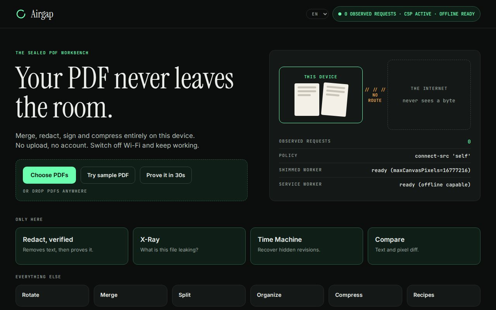
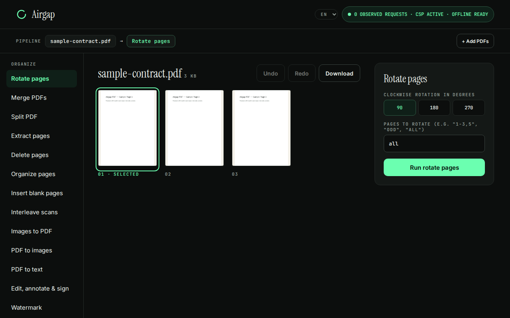
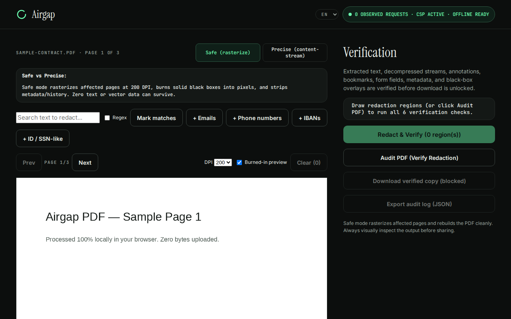

<div align="center">

# Airgap PDF

**PDF tools that keep working with the Wi-Fi switched off. Because that's how they work.**

Merge, split, sign, redact, compress, OCR, compare and audit PDFs entirely in your browser.
No upload. No server. No account. No analytics.
Don't take our word for it: [prove it in 30 seconds](#prove-it-in-30-seconds).

[Live app](https://jamesuchechi.github.io/airgap-pdf/) ·
[Architecture](./ARCHITECTURE.md) ·
[Roadmap](./TODO.md) ·
[Contributing](./CONTRIBUTING.md) ·
[Security](./SECURITY.md)

[](https://github.com/Jamesuchechi/airgap-pdf/actions/workflows/ci.yml)
[](https://github.com/Jamesuchechi/airgap-pdf/actions/workflows/deploy.yml)


</div>

> **Status: v0.1.0 shipped.** Every tool marked ✅ below is implemented, tested in CI (Vitest + Playwright across Chromium, Firefox, and WebKit), and works offline.

---

## Table of contents

1. [Why this exists](#why-this-exists)
2. [Prove it in 30 seconds](#prove-it-in-30-seconds)
3. [What you can do](#what-you-can-do)
4. [Beyond the usual toolkit](#beyond-the-usual-toolkit)
5. [Recipes: CyberChef for PDFs](#recipes-cyberchef-for-pdfs)
6. [Quick start](#quick-start)
7. [CLI](#cli)
8. [Embedding](#embedding)
9. [Limits, stated honestly](#limits-stated-honestly)
10. [How it compares](#how-it-compares)
11. [Add a tool in five minutes](#add-a-tool-in-five-minutes)
12. [Project structure](#project-structure)
13. [FAQ](#faq)
14. [Security and privacy policy](#security-and-privacy-policy)
15. [License](#license)
16. [Acknowledgements](#acknowledgements)

---

## Why this exists

Merging two PDFs should not require handing a contract, a payslip or a passport scan to a stranger's server.

Yet the dominant PDF sites do exactly that: you upload, they process, you download, and you trust
their retention policy. Their free tiers cap you at a few tasks a day, and the paid tiers monetise the
fact that you have a deadline.

Modern browsers can do all of this locally. WebAssembly runs the same engines that servers use.
Airgap PDF is what you get when you take that seriously:

- **The architecture is the privacy policy.** There is no backend to send files to.
- **Everything is verifiable.** The claims below are things you can check, not things you must believe.
- **It goes further than the incumbents** on the things that matter to people who handle sensitive
  documents: real redaction, a leak auditor, revision recovery, and reproducible tool pipelines.

---

## Prove it in 30 seconds

Privacy claims are cheap. Here is how to check this one yourself.

1. **Watch the network.** Open DevTools → Network, then run any tool on any file.
   After the initial page load you should see no requests carrying your data, and no requests to any
   third-party origin at all.
2. **Pull the plug.** Load the app once, switch on airplane mode, and keep working. Install it as a PWA
   and it opens offline from a cold start.
3. **Open the Trust panel** (shield icon, top right). It shows `"0 observed requests · CSP active"`, the
   Content-Security-Policy in force, the origins the page is allowed to talk to (only its own), and
   the requests observed this session.
4. **Verify the build.** Every deployment is built in public CI with a signed provenance attestation and
   a manifest of file hashes. Compare what your browser received against what CI built:

   ```bash
   npx @airgap-pdf/verify https://jamesuchechi.github.io/airgap-pdf/
   ```

5. **Read the code.** The privacy-relevant surface is deliberately small. See
   [ARCHITECTURE.md → Trust architecture](./ARCHITECTURE.md#11-trust-architecture).

### What we guarantee

- The app is a static site. There is no server-side code and no API to receive files.
- A Content-Security-Policy restricts network connections to the app's own origin. No CDNs, no
  third-party fonts, no analytics, no error-reporting service.
- Files are held in memory by default. Persistence (so a workspace survives a refresh) is opt-in.

### What we do not claim

- We cannot protect you if your browser, your OS or a browser extension is compromised.
- We cannot protect you from a malicious deployment of this code served from somewhere that is not
  the official origin (or a modified build that strips the `<meta>` CSP). That is what `@airgap-pdf/verify`
  and the attestations are for.
- "Observed requests" in the Trust panel is a best-effort view, not a mathematical proof. The
  architecture doc is explicit about what it can and cannot see.

---

## What you can do

| Area | Tool | Status |
|---|---|---|
| **Organize** | Merge multiple PDFs | ✅ |
| | Split by range, every N pages, or custom ranges | ✅ |
| | Reorder pages visually (drag and drop thumbnails, rotate-in-place) | ✅ |
| | Rotate, delete, duplicate, extract pages | ✅ |
| | Insert blank pages; interleave two scans (odd/even) | ✅ |
| **Read & Edit** | **Document Reader & Live Editor** (zoom, search, inline text edit, blank PDF) | ✅ |
| | Draw / type / upload a signature and place it | ✅ |
| | Fill AcroForms; flatten forms | ✅ |
| | Annotate: highlight, text box, freehand ink | ✅ |
| | Watermark, page numbers, headers/footers, crop, resize to A4 / Letter | ✅ |
| | Bates numbering (legal) | ✅ |
| | Edit metadata | ✅ |
| **Convert** | Images → PDF (JPG, PNG, WebP) | ✅ |
| | PDF → images (PNG/JPEG, chosen DPI with iOS pixel cap) | ✅ |
| | PDF → text / Markdown (text-layer PDFs) | ✅ |
| | Scanned PDF → searchable PDF (local Tesseract.js OCR + language-pack manager) | ✅ |
| **Protect** | Password-protect (AES-256) / unlock (when you know the password) | ✅ |
| | **Redact: Safe (rasterize) & Precise (content-stream) + post-redaction verifier** | ✅ |
| | **Sanitize: strip metadata, JS, attachments, hidden layers, with removal summary** | ✅ |
| **Inspect** | **X-Ray: what is this PDF leaking?** | ✅ |
| | **Time Machine: recover earlier revisions hidden in a file** | ✅ |
| | **Verify Redaction: audit any PDF for black boxes over text & hidden leaks** | ✅ |
| **Compare** | Myers text diff + perceptual visual diff overlay + PDF report export | ✅ |
| **Optimize** | Compress (image recompression, object streams, never-make-bigger guard) | ✅ |
| **Scan** | Phone camera → edge detection, perspective warp, filters, multi-page PDF | ✅ |
| **Automate** | Recipes (URL-fragment JSON), `@airgap-pdf/cli`, `#/embed/<tool>`, PWA handlers | ✅ |

### Screenshots

| Home & Trust Telemetry | Workbench | Redact & Verify |
|---|---|---|
|  |  |  |

---

## Beyond the usual toolkit

Everyone ships merge and split. These are the parts that make Airgap PDF worth switching to.

### Redaction that actually redacts

Drawing a black box over text and saving does not remove the text. People have leaked sensitive
material this way, repeatedly. Airgap PDF offers two modes:

- **Safe:** affected pages are rasterised, so nothing underneath can survive.
- **Precise:** the underlying text and image data is removed from the content stream, keeping the page
  selectable and small.

Either way, the result is **verified automatically**: the output is re-parsed, and every redacted
string is searched for in page text, raw decompressed streams, annotations, bookmarks, form fields,
attachments and metadata. If it finds anything, it tells you instead of saying "done".

### Verify Redaction

Got a "redacted" PDF from someone else, and want to know whether it is actually safe to forward?
Drop it in. The auditor looks for text hiding under boxes, previous revisions, and sensitive
metadata, and reports what it found.

### X-Ray

A one-screen report of everything a PDF carries that you did not mean to share: author and company,
the software and username that produced it, creation and modification history, embedded files,
JavaScript, hidden layers, comments, form data, and GPS EXIF inside embedded photos. One click
produces a sanitised copy.

### Time Machine

PDFs are often saved *incrementally*: edits are appended instead of rewriting the file, so earlier
versions can still be inside it. Time Machine lists the revisions it can find and lets you view,
diff or export each one. Use it to check what you are about to send, or to recover what you deleted.

### Compare

Two versions of a contract, side by side: a text diff with insertions and deletions, plus a visual
overlay that catches changes text extraction cannot see (figures, signatures, layout).

### Scanner mode

On a phone, use the camera to capture pages, auto-detect edges, correct perspective, clean up and
export one PDF. Nothing leaves the device.

### Recipes

Chain tools into a pipeline, save it, and share it as a link. See below.

### It installs, and it integrates

- Installable PWA that works offline.
- Registers as a PDF handler where the platform supports it, so "Open with Airgap PDF" works.
- Accepts files from the system Share sheet on Android.
- A real CLI that runs the same code as the browser.

---

## Recipes: CyberChef for PDFs

A recipe is an ordered list of tool steps. It is plain JSON, validated against each tool's schema,
and it never contains your files.

```json
{
  "v": 1,
  "name": "Send-safe contract",
  "steps": [
    { "tool": "merge",    "options": {} },
    { "tool": "sanitize", "options": { "metadata": true, "javascript": true, "attachments": true } },
    { "tool": "watermark","options": { "text": "CONFIDENTIAL", "opacity": 0.12, "angle": 35 } },
    { "tool": "compress", "options": { "level": "balanced" } }
  ]
}
```

Share one as a link. The recipe is compressed and stored in the URL **fragment**, which browsers
never send to any server:

```
https://jamesuchechi.github.io/airgap-pdf/#/recipe?r=eJyr...
```

Open the link, drop in your files, press Run. The same JSON runs in the CLI.

---

## Quick start

### Use it

Open the [live app](https://jamesuchechi.github.io/airgap-pdf/). That is the whole install.
Optionally, use your browser's *Install app* option to get a standalone offline copy.

### Run it locally

Requirements: Node 22+ and pnpm 9+ (`corepack enable` is enough).

```bash
git clone https://github.com/Jamesuchechi/airgap-pdf.git
cd airgap-pdf
corepack enable
pnpm install
pnpm dev                 # http://localhost:5173/airgap-pdf/
```

Other commands:

```bash
pnpm check               # lint + typecheck + unit tests
pnpm test:e2e            # Playwright, including the zero-network and offline suites
pnpm build               # static site in apps/web/dist
pnpm preview             # serve the production build locally
pnpm corpus:fetch        # download the larger optional test-PDF corpus
```

### Host it yourself

`apps/web/dist` is plain static files. Put it on GitHub Pages, Netlify, S3, an intranet web server,
or a USB stick with `python -m http.server`. Set `BASE_PATH` at build time if you are not serving
from `/airgap-pdf/`:

```bash
BASE_PATH=/ pnpm build
```

---

## CLI

*Planned (M9). Same tools, same options, same recipes.*

```bash
npx @airgap-pdf/cli merge a.pdf b.pdf -o out.pdf
npx @airgap-pdf/cli split big.pdf --every 10 -o parts/
npx @airgap-pdf/cli xray contract.pdf --json
npx @airgap-pdf/cli run recipe.json in.pdf -o out.pdf
```

Flags are generated from each tool's schema, so a new tool gets a CLI for free.

---

## Embedding

*Planned (M9).* Drop a single tool into your own site. The file stays inside the iframe, which is
served from the same static origin as the app.

```html
<iframe
  src="https://jamesuchechi.github.io/airgap-pdf/#/embed/merge"
  width="100%" height="560" allow="clipboard-write" loading="lazy"></iframe>
```

An optional `postMessage` API lets the host page receive the finished file.

---

## Limits, stated honestly

| Topic | Reality |
|---|---|
| **File size** | Everything lives in browser memory. Plan on roughly 100-200 MB comfortably on desktop and far less on phones. The app warns before it tries something that will not fit. Exact ceilings are measured per browser in a spike and published here. |
| **Speed** | WebAssembly is fast, but not server-grade for OCR and compression on huge files. Work runs in background threads so the UI never freezes. |
| **First load** | Core tools are small. Heavy engines (OCR, compression) download only when you open that tool, then are cached for offline use. |
| **Word / Excel / PowerPoint ↔ PDF** | **Not supported.** No credible client-side engine exists. We would rather say so than ship something that mangles your document. |
| **Digital (cryptographic) signatures** | The signature tool places a *visual* signature. Cryptographic PAdES signing is a separate, later milestone. |
| **PDF/A, PDF/UA conversion** | Out of scope for now. |
| **XFA forms** | Not supported. AcroForms are. |
| **Password-protected files** | You must know the password. This is not a cracking tool. |
| **Old browsers** | Evergreen browsers only. See the support matrix in [ARCHITECTURE.md](./ARCHITECTURE.md#22-browser-support-and-degradation). |

### Measured Limits & Bundle Ceilings

| Metric | Measured / Enforced Value |
|---|---|
| **Desktop input ceiling** | `500 MB` (`maxInputBytesDesktop`) |
| **Mobile input ceiling** | `150 MB` (`maxInputBytesMobile`) |
| **Max page count** | `5,000` pages (`maxPages`) |
| **Max canvas pixels** | `16,777,216` px (4096 × 4096, iOS Safari safe cap) |
| **Max render DPI** | `300` DPI (`maxRenderDpi`) |
| **Max single stream / total decoded** | `256 MB` / `2 GB` |
| **Max PDF object depth** | `100` (`maxObjectDepth`) |
| **Worker watchdog timeout** | `30,000 ms` (`watchdogMs`) |
| **Production CSS bundle** | `14.4 KB` (budget: `<= 50 KB`) |
| **Production largest JS chunk** | `1458.6 KB` (`pdfjs-dist` + `pdf-lib` + app, budget: `<= 1700 KB`) |
| **Compression benchmark** | `9563 B -> 8670 B` (`9.3%` saved in `14.0 ms` on 20-page text PDF) |

---

## How it compares

| | Airgap PDF | Typical online PDF sites | Acrobat (online) | Self-hosted server tools |
|---|---|---|---|---|
| Your file leaves your device | **No** | Yes | Yes | To *your* server |
| Works offline | **Yes** | No | No | If you run it locally |
| Account or sign-up required | **No** | Often | Yes | No |
| Daily task or size caps | **No** | Common on free tiers | Plan-dependent | No |
| Open source | **Yes** | No | No | Often |
| Verifiable build | **Yes** | No | No | Varies |
| Needs infrastructure to run | **None** | n/a | n/a | A server |
| Office-format conversion | No | Yes | Yes | Often |

---

## Add a tool in five minutes

Every tool is one folder with one module. You describe the options once as a schema; the web UI form,
the CLI flags and recipe validation are all derived from it.

```bash
pnpm new:tool rotate     # scaffolds packages/tools/src/rotate/{index.ts,rotate.test.ts,README.md}
```

```ts
// packages/tools/src/rotate/index.ts
import { z } from 'zod';
import { defineTool, pageRange, ok } from '@airgap-pdf/core';

export default defineTool({
  id: 'rotate',
  name: 'Rotate pages',
  summary: 'Rotate selected pages by 90, 180 or 270 degrees.',
  category: 'organize',
  accepts: { mime: ['application/pdf'], min: 1, max: 1 },
  produces: 'pdf',
  runtime: ['browser', 'node'],
  options: z.object({
    degrees: z.union([z.literal(90), z.literal(180), z.literal(270)]).default(90),
    pages: pageRange().default('all'),
  }),

  async run(ctx, [input], { degrees, pages }) {
    const doc = await ctx.pdf.open(input);
    for (const index of doc.resolveRange(pages)) {
      doc.page(index).rotateBy(degrees);
      ctx.progress((index + 1) / doc.pageCount);
    }
    return ok(await doc.save({ name: `${input.stem}-rotated.pdf` }));
  },
});
```

Then:

1. Add a test with a fixture from `corpus/`. The test harness checks the invariants every tool must satisfy:
   output opens, page counts make sense, cancellation works, no network calls happen.
2. Run `pnpm check`.
3. Open a PR. CI runs the full suite, including the zero-network end-to-end test, against your tool.

See [CONTRIBUTING.md](./CONTRIBUTING.md) for the full checklist, and
[ARCHITECTURE.md](./ARCHITECTURE.md#6-the-tool-contract) for the contract.

---

## Project structure

```
airgap-pdf/
├─ apps/
│  └─ web/              React + Vite PWA (the product)
├─ packages/
│  ├─ core/             Tool contract, recipes, limits, errors. No DOM. Runs in browser and Node.
│  ├─ verify/           Build verifier (hashes + provenance) — added in M2
│  └─ cli/              Node CLI sharing core + tools — added in M9
├─ corpus/              Test PDFs: normal, hostile, and weird
├─ e2e/                 Playwright suites (zero-network, offline, mobile)
├─ docs/adr/            Architecture decision records
├─ ARCHITECTURE.md
├─ TODO.md
└─ CONTRIBUTING.md
```

---

## FAQ

**Is it really private?**
Yes, and you can check. See [Prove it in 30 seconds](#prove-it-in-30-seconds). The honest caveat is in
[What we do not claim](#what-we-do-not-claim).

**Why not just run a server and call it a day?**
Because then your files leave your device, the project needs funding to keep running, and users have to
trust an operator. A static site removes all three problems.

**Can I use it for legal, HR or medical documents?**
It was designed with those users in mind. Please still follow your own organisation's rules, and review
the [security policy](./SECURITY.md).

**Why no Word conversion?**
Faithful Office rendering needs an engine that does not run well in a browser today. Shipping a
lossy converter would damage people's documents.

**How is this funded?**
It is not, and it does not need to be: there is no infrastructure to pay for. Sponsorship is welcome
but nothing is gated behind it. There are no premium tiers and no usage limits.

**Does it collect analytics?**
No. No telemetry, no tracking, no error reporting. The "Copy debug info" button produces a report
*you* can choose to paste into an issue; it contains no file content.

**Where do my files go if I close the tab?**
Nowhere. By default nothing is persisted. If you turn on *Remember my workspace*, files are kept in
your browser's private storage on your device, and there is a one-click "Wipe everything".

---

## Security and privacy policy

- Report vulnerabilities privately via GitHub Security Advisories. See [SECURITY.md](./SECURITY.md).
- PDFs are treated as hostile input: resource limits, no script execution, sandboxed parsing in
  workers. See [ARCHITECTURE.md → Security for untrusted PDFs](./ARCHITECTURE.md#12-security-for-untrusted-pdfs).
- The privacy posture is a feature with tests, not a paragraph: CI fails if any tool makes a
  network request.

---

## License

See [LICENSE](./LICENSE). The licensing strategy, including how heavy engines with copyleft licenses
are handled, is tracked in [ADR-0002](./docs/adr/0002-license.md).

---

## Acknowledgements

Built on the shoulders of [pdf-lib](https://github.com/Hopding/pdf-lib) and [@cantoo/pdf-lib](https://github.com/cantoo-scribe/pdf-lib),
[PDF.js](https://github.com/mozilla/pdf.js), [qpdf](https://github.com/qpdf/qpdf),
[Tesseract.js](https://github.com/naptha/tesseract.js), [fflate](https://github.com/101arrowz/fflate),
[Comlink](https://github.com/GoogleChromeLabs/comlink) and [CyberChef](https://github.com/gchq/CyberChef),
whose recipe idea we gratefully borrowed.